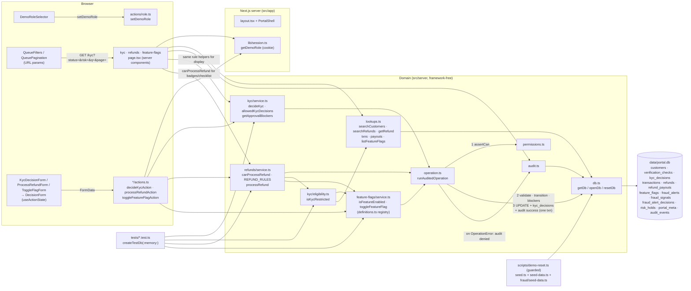

# Architecture

One local Next.js process serves UI and server actions and talks to one SQLite file. No external APIs,
no real auth: the demo role is an untrusted cookie checked by server-side policy.

## Request flow (KYC decision)

1. `KycDecisionForm` (configures the generic `DecisionForm`) submits `customerId`, `decision`
   (`approve | reject | request_info`) and `note` to `decideKycAction`.
2. The action reads the role claim with `getDemoRole()` and calls `decideKyc(getDb(), role, input)`.
3. `decideKyc` runs inside `runAuditedOperation`: `assertCan(role, "kyc.decide")` → Zod (note required) →
   load customer → `KYC_TRANSITIONS` → for approve, `getApprovalBlockers(checks)` must be empty →
   update `customers.kyc_status`, insert `kyc_decisions`, write the `success` audit row — one transaction.
4. Any `OperationError` rolls back, writes a `denied` audit row, and returns `{ ok: false, code, message }`
   (e.g. `rule_violation: Cannot approve: proof of address is missing.`).
5. The action calls `revalidatePath("/kyc")`; the form renders the result via `OperationFeedback`.
6. The page calls `allowedKycDecisions` / `getApprovalBlockers` to decide which buttons and explanations to
   show — the same functions the service enforces, so UI and backend cannot drift.

## KYC rules

| From | Allowed decisions | Notes |
| ---- | ----------------- | ----- |
| `pending` | approve, reject, request_info | approve requires identity + address `passed`, sanctions + PEP `clear` |
| `info_requested` | approve, reject | same approval rule |
| `approved`, `rejected` | — | read-only (no reopen workflow) |

Each customer row carries `review_type` (`onboarding | periodic_refresh | triggered`) and `review_reason` explaining
why the case is in the queue. Onboarding applicants have no account activity until approved; re-reviews are existing
customers (history shows the original `approve` and a `system` `open_review` row) and keep their transactions/refunds.

`isKycRestricted(db, customerId)` — when flag `block_refunds_unverified_kyc` is ON, any customer whose current status is
not `approved` (including `info_requested`) is restricted. Used by the Refunds `KYC_NOT_APPROVED` rule.

## Refunds

`src/server/refunds/service.ts` holds the **only** refund eligibility logic:

- `REFUND_RULES` — ordered list of `{ code, label, errorCode, check(ctx) }`. Order is error precedence
  (`forbidden` → `invalid_transition` → `rule_violation`).
- `canProcessRefund(db, role, refundId)` → `{ eligible, refund, checks[], reasons[{code,message}], errorCode }`.
  The page uses it for the queue "Eligibility" badges, the detail checklist and summary counts; `processRefund` uses it
  for enforcement. `businessBlockers()` drops `ROLE_NOT_PERMITTED` for "what any operator would hit" displays.
- `processRefund(db, role, { refundId, note })` inside `runAuditedOperation`: Zod → `canProcessRefund` (throws
  `OperationError(errorCode, message, { reasons })`) → guarded `UPDATE refunds … WHERE id = ? AND status = 'pending'`
  → `INSERT refund_payouts` (UNIQUE `refund_id`) → success audit, all in one transaction. A stale second submit hits the
  rule (`ALREADY_REFUNDED`) or, in a race, the guarded update; the UNIQUE constraint is the last line of defence.

| Code | Rule | Error code |
| ---- | ---- | ---------- |
| `ROLE_NOT_PERMITTED` | role lacks `refund.process` (Payments Operator only) | `forbidden` |
| `ALREADY_REFUNDED` | refund status is `processed` | `invalid_transition` |
| `REFUND_NOT_PENDING` | refund status is `rejected` | `invalid_transition` |
| `DUPLICATE_REFUND` | other processed refunds on the same transaction + this one exceed the transaction amount | `rule_violation` |
| `KYC_NOT_APPROVED` | `block_refunds_unverified_kyc` ON and `isKycRestricted` | `rule_violation` |
| `REFUNDS_PAUSED` | `pause_refund_processing` ON | `rule_violation` |
| `AMOUNT_OVER_LIMIT` | `block_high_value_refunds` ON and amount > $1,000 | `rule_violation` |
| `ACCOUNT_RISK_HOLD` | customer has an **active** row in `risk_holds` (Fraud Operations Escalate & Hold); process only — reject/claim still allowed | `rule_violation` |

Denied audit rows carry `details.reasons` (all failing codes). `ACCOUNT_RISK_HOLD` was added as one appended
rule — the Refunds queue badge, refund page checklist/banner, bulk processing and `processRefund` all picked it up with no
other change.

## Fraud Operations

`decideFraudAlert(db, role, { alertId, decision: "dismiss" | "escalate", note }, now)` in `src/server/fraud/service.ts`:
permission (`fraud_alert.dismiss` / `fraud_alert.escalate`, Risk Admin only) → Zod (reason required) → load alert →
`FRAUD_ALERT_TRANSITIONS` (`open → dismissed | escalated`; repeated escalation = `DUPLICATE_ESCALATION`, anything
else = `INVALID_ALERT_TRANSITION`) → guarded `UPDATE … WHERE status = 'open'` → (escalate) insert `risk_holds` row →
append `fraud_alert_decisions` → success audit. All inside `runAuditedOperation`, so a failed audit write rolls back the
transition and the hold. Priya Shah's seeded escalation goes through this same function at a fixed timestamp.

**Queue actions share the rules.** Each rule lists the `actions` it gates (`process | reject | claim`);
`evaluateRefundRules(db, role, id, action, payoutCents?)` filters by action, and `canProcessRefund` / `canRejectRefund`
are thin wrappers. Role + state rules gate every action; money/flag rules gate only `process`. Every service checks the
action's permission (`refund.process`, `refund.reject`, `refund.claim`) **before** Zod, so a forbidden role is audited as
`ROLE_NOT_PERMITTED`, not as a validation error.

| Action | Service | Audit action | Notes |
|---|---|---|---|
| Reject | `rejectRefund` | `refund.reject` | guarded `pending → rejected`; no payout; flags never block declining |
| Partial | `processRefund({ amount })` | `refund.process` (`partial: true`) | `approved_amount_cents` ≤ request (`AMOUNT_EXCEEDS_REQUEST`); payout = approved; `DUPLICATE_REFUND` sums paid-out amounts; `AMOUNT_OVER_LIMIT` uses the requested amount so partials can't bypass the limit |
| Claim / release | `claimRefund` | `refund.claim` / `refund.release` | `assigned_to`/`assigned_at`; `ALREADY_CLAIMED` / `NOT_CLAIMED`; does not lock processing |
| Bulk | `bulkProcessRefunds` | `refund.bulk_process` (entity `refund_batch`) + one `refund.process` per refund | each refund runs `processRefund` in a nested savepoint, so blocked ones are denied/audited without rolling back the rest |

## Feature flags

`src/server/feature-flags/definitions.ts` is the registry (key, label, description, where it is enforced, the refund
block code it produces, seed default); `seed.ts` inserts one `feature_flags` row per definition. `isFeatureEnabled(db, key)`
reads the row on every call, so a toggle is effective on the next request (no cache). `toggleFeatureFlag(db, role,
{ key, decision: enable|disable, note })` — `assertCan("feature_flag.toggle")` (Risk Admin only) → Zod (key must be in
the registry) → `allowedFlagDecisions(enabled)` (no-op toggles are `invalid_transition`) → guarded UPDATE with
`updated_by_role` → audit `feature_flag.enable|disable` with `{ from, to, note }`. The action revalidates `/feature-flags`
and `/refunds`.

## Adding another workflow (e.g. Transaction Risk Review)

0. **Scaffold** — `npm run new:workflow -- <slug> --entity <type> --role <role>`; then rename the generated
   `<slug>.decide` permission to a `<noun>.<verb>` name and replace every TODO (the stub tests are `it.todo`).
1. **Policy** — add a permission to `PERMISSIONS` in `src/server/permissions.ts` (e.g. `"refund.process": ["payments_operator"]`).
2. **Reads** — add queries to `src/server/lookups.ts` (refund/transaction lookups already exist). For a queue, add a
   `parse<X>Query` Zod schema with `.catch()` defaults and a `search<X>` function like `searchCustomers`.
3. **Service** — create `src/server/<workflow>/service.ts` modelled on `src/server/kyc/service.ts`:
   Zod schema, transition map, exported rule helpers (used by both page and service), one exported function per
   mutation that wraps `runAuditedOperation`. Reuse cross-workflow gates such as `isKycRestricted` and
   `isFeatureEnabled`. When several rules decide one action, use an ordered rule list + a `can<Action>()` that returns
   structured reasons (see Refunds) and pass `{ reasons }` as `OperationError` details for the denied audit row.
4. **Tests** — `tests/<workflow>.test.ts` using `createTestDb()`: success + persistence, forbidden role,
   invalid transition, rule violation, validation, audit rows.
5. **Action** — `src/app/<workflow>/actions.ts`, a thin `"use server"` adapter like `src/app/kyc/actions.ts`.
6. **UI** — two pages, queue + case (see `src/app/kyc/`):
   - `src/app/<workflow>/page.tsx`: `PageHeader`, `SummaryCards`, `QueueFilters`, full-width `QueueTable`
     (`getRowHref={(r) => withParams(\`/<workflow>/${r.id}\`, params)}`), `QueuePagination`.
   - `src/app/<workflow>/[id]/page.tsx`: `RecordNav` (back keeps filters; prev/next from a `get<X>QueueNeighbours`
     lookup reusing the queue's WHERE/sort), a header card (status + why it needs attention), `RecordTabs`
     (Overview with the decision form first, then related activity, then history/audit), `RecordFields`, `StatusBadge`,
     and a small client wrapper around `DecisionForm` passing `successAction` = "Next" link.
   - Actions call `revalidatePath("/<workflow>", "layout")` so both pages refresh.
7. **Nav** — set `available: true` in `src/lib/workflows.ts`.
8. **Schema/seed** — only if needed: edit `schema.ts` (bump `SCHEMA_VERSION`), `seed-data.ts`/`seed.ts`, then `npm run db:reset`.
9. Update `AGENTS.md` file map and this doc.
