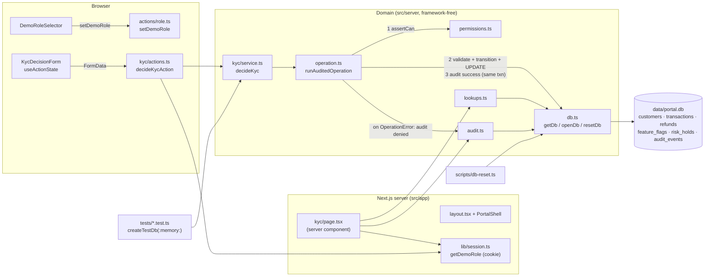

# Architecture

One local Next.js process serves UI and server actions and talks to one SQLite file. No external APIs,
no real auth: the demo role is an untrusted cookie checked by server-side policy.

## Request flow (KYC approve)

1. `KycDecisionForm` submits `customerId`, `decision`, `note` to `decideKycAction`.
2. The action reads the role claim with `getDemoRole()` and calls `decideKyc(getDb(), role, input)`.
3. `decideKyc` runs inside `runAuditedOperation`: `assertCan(role, "kyc.decide")`, Zod validation,
   load customer, check `KYC_TRANSITIONS`, update the row. The `success` audit row is written in the same
   transaction.
4. Any `OperationError` rolls back, writes a `denied` audit row, and returns `{ ok: false, code, message }`.
5. The action calls `revalidatePath("/kyc")`; the form renders the result via `OperationFeedback`.

## Adding another workflow (e.g. Refunds)

1. **Policy** — add a permission to `PERMISSIONS` in `src/server/permissions.ts` (e.g. `"refund.process": ["payments_operator"]`).
2. **Reads** — add any missing queries to `src/server/lookups.ts` (refund/transaction lookups already exist).
3. **Service** — create `src/server/<workflow>/service.ts` modelled on `src/server/kyc/service.ts`:
   Zod schema, transition map, one exported function per mutation that wraps `runAuditedOperation`.
4. **Tests** — `tests/<workflow>.test.ts` using `createTestDb()`: success + persistence, forbidden role,
   invalid transition, validation, audit rows.
5. **Action** — `src/app/<workflow>/actions.ts`, a thin `"use server"` adapter like `src/app/kyc/actions.ts`.
6. **UI** — `src/app/<workflow>/page.tsx` composing `PageHeader`, `QueueTable`, `RecordDetail`,
   `StatusBadge`; a client form with `useActionState` + `OperationFeedback`.
7. **Nav** — set `available: true` in `src/lib/workflows.ts`.
8. **Schema/seed** — only if needed: edit `schema.ts`/`seed.ts`, then `npm run db:reset`.
9. Update `AGENTS.md` file map and this doc.
