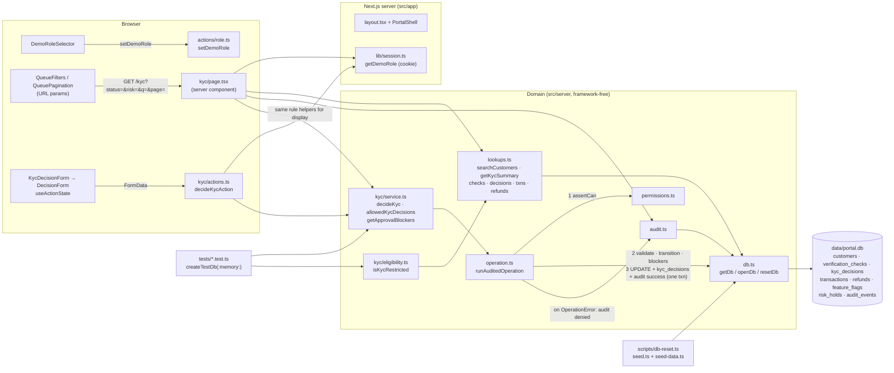

# Architecture

One local Next.js process serves UI and server actions and talks to one SQLite file. No external APIs,
no real auth: the demo role is an untrusted cookie checked by server-side policy.

## Request flow (KYC decision)

1. `KycDecisionForm` (configures the generic `DecisionForm`) submits `customerId`, `decision`
   (`approve | reject | request_info`) and `note` to `decideKycAction`.
2. The action reads the role claim with `getDemoRole()` and calls `decideKyc(getDb(), role, input)`.
3. `decideKyc` runs inside `runAuditedOperation`: `assertCan(role, "kyc.decide")` → Zod (note required) →
   load customer → `KYC_TRANSITIONS` → for approve, `getApprovalBlockers(checks)` must be empty →
   update `customers.kyc_status`, insert `kyc_decisions`, write the `success` audit row — one transaction.
4. Any `OperationError` rolls back, writes a `denied` audit row, and returns `{ ok: false, code, message }`
   (e.g. `rule_violation: Cannot approve: proof of address is missing.`).
5. The action calls `revalidatePath("/kyc")`; the form renders the result via `OperationFeedback`.
6. The page calls `allowedKycDecisions` / `getApprovalBlockers` to decide which buttons and explanations to
   show — the same functions the service enforces, so UI and backend cannot drift.

## KYC rules

| From | Allowed decisions | Notes |
| ---- | ----------------- | ----- |
| `pending` | approve, reject, request_info | approve requires identity + address `passed`, sanctions + PEP `clear` |
| `info_requested` | approve, reject | same approval rule |
| `approved`, `rejected` | — | read-only (no reopen workflow) |

`isKycRestricted(db, customerId)` — when flag `kyc_restriction` is ON, any customer whose current status is not
`approved` (including `info_requested`) is restricted. Refunds (Session 2) should call it.

## Adding another workflow (e.g. Refunds)

1. **Policy** — add a permission to `PERMISSIONS` in `src/server/permissions.ts` (e.g. `"refund.process": ["payments_operator"]`).
2. **Reads** — add queries to `src/server/lookups.ts` (refund/transaction lookups already exist). For a queue, add a
   `parse<X>Query` Zod schema with `.catch()` defaults and a `search<X>` function like `searchCustomers`.
3. **Service** — create `src/server/<workflow>/service.ts` modelled on `src/server/kyc/service.ts`:
   Zod schema, transition map, exported rule helpers (used by both page and service), one exported function per
   mutation that wraps `runAuditedOperation`. Reuse cross-workflow gates such as `isKycRestricted`.
4. **Tests** — `tests/<workflow>.test.ts` using `createTestDb()`: success + persistence, forbidden role,
   invalid transition, rule violation, validation, audit rows.
5. **Action** — `src/app/<workflow>/actions.ts`, a thin `"use server"` adapter like `src/app/kyc/actions.ts`.
6. **UI** — `src/app/<workflow>/page.tsx` composing `PageHeader`, `SummaryCards`, `QueueFilters`, `QueueTable`,
   `QueuePagination`, `RecordDetail`, `StatusBadge`; a small client wrapper around `DecisionForm`.
7. **Nav** — set `available: true` in `src/lib/workflows.ts`.
8. **Schema/seed** — only if needed: edit `schema.ts` (bump `SCHEMA_VERSION`), `seed-data.ts`/`seed.ts`, then `npm run db:reset`.
9. Update `AGENTS.md` file map and this doc.
